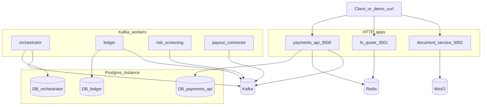
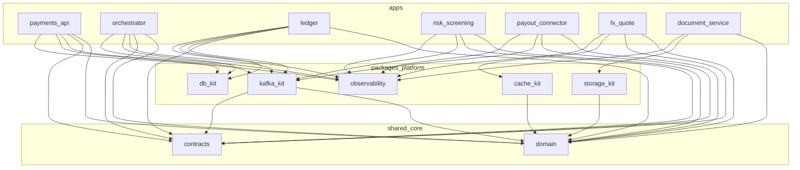
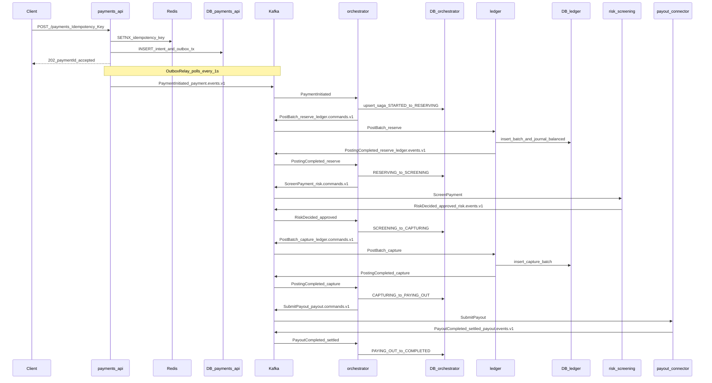
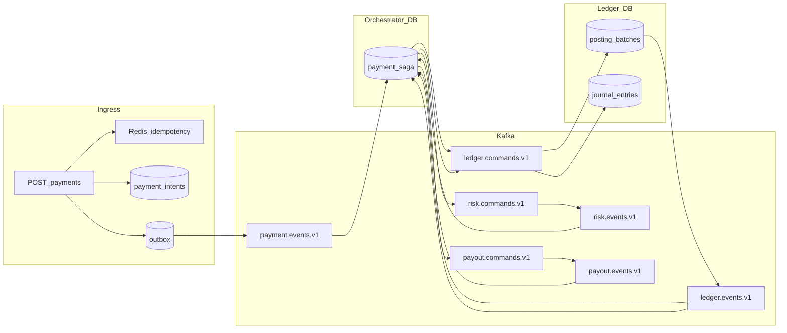
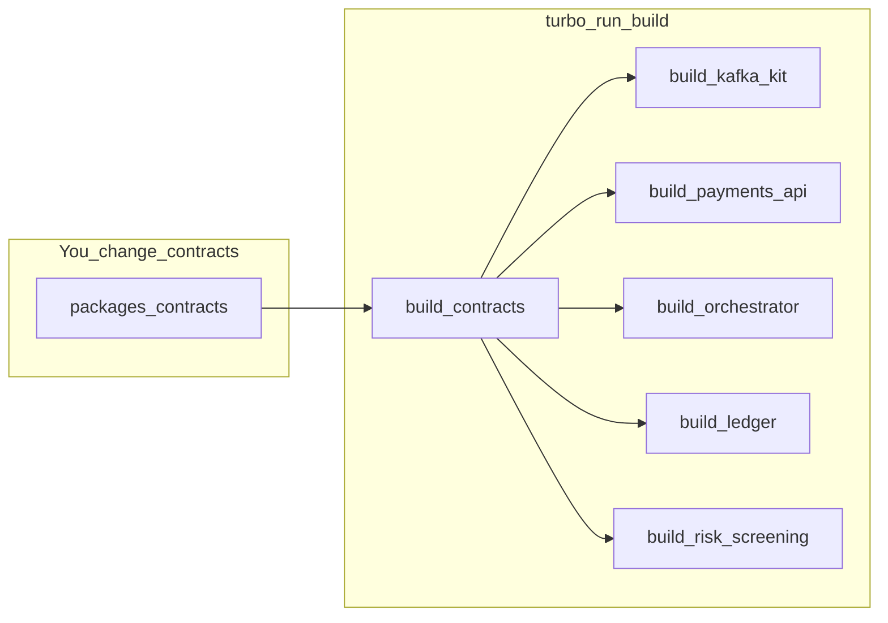
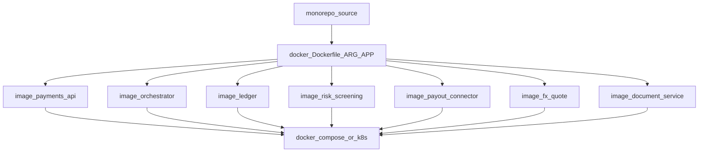

# Cross-border payment ledger POC — architecture guide

This document is a presentation script for engineers who know **NestJS** and **SQL**, and need to evaluate whether to move from **multi-repo microservices** to a **Bun workspaces + Turborepo monorepo**.

It describes what is implemented in this repository today — not a future roadmap.

---

## 1. What problem this POC demonstrates

A cross-border payment is not one HTTP request that updates one table. It is a **multi-step workflow** across several services:

1. Accept a payment intent (HTTP).
2. Reserve funds in a ledger (accounting).
3. Screen for sanctions / AML (risk).
4. Capture funds (ledger again).
5. Submit payout to an external rail (payout connector).
6. Mark the saga complete (or compensate on failure).

Services talk asynchronously over **Kafka**. Each stateful service owns **its own Postgres database**. Shared code lives in packages — not shared tables.

The POC asks: *can we keep microservice boundaries (deploy independently, own data, talk over events) while sharing contracts and platform code in one repo with Turborepo?*

---

## 2. Repository layout (mental model)

```
monorepo-nestjs/
├── apps/                    # Deployable NestJS services (microservices)
│   ├── payments-api         # HTTP ingress + outbox
│   ├── orchestrator         # Saga decision-maker (no HTTP)
│   ├── ledger               # Journal writer (no HTTP)
│   ├── risk-screening       # Risk worker (stub rules)
│   ├── payout-connector     # Rail adapter (stub rail)
│   ├── fx-quote             # FX HTTP API (off payment path)
│   └── document-service     # MinIO presigns (off payment path)
├── packages/
│   ├── domain               # Pure business rules (no Nest, no SQL)
│   ├── contracts            # Zod Kafka wire schemas + topic names
│   └── platform/            # Reusable infra kits
│       ├── kafka-kit
│       ├── db-kit
│       ├── cache-kit
│       ├── storage-kit
│       └── observability
├── test/e2e                 # Testcontainers e2e (reserve path)
├── docker/                  # Dockerfile, init scripts, entrypoint
└── docker-compose.yml       # Infra + migrate jobs + all apps
```

**Bun workspaces** (`package.json` → `workspaces`) link `@monorepo/*` packages locally.  
**Turborepo** (`turbo.json`) orchestrates `build` / `lint` / `test` with a dependency graph and cache.

---

## 3. High-level design (HLD)

### 3.1 Services at a glance

| App | Responsibility | How you talk to it | Own DB? |
|-----|----------------|--------------------|---------|
| `payments-api` | Accept payment, persist intent, publish via outbox | HTTP `:3000` | Yes — `payments_api` |
| `orchestrator` | Only service that advances the saga | Kafka only | Yes — `orchestrator` |
| `ledger` | Only service that writes journal postings | Kafka only | Yes — `ledger` |
| `risk-screening` | Approve / decline screening | Kafka only | No |
| `payout-connector` | Submit / reconcile external payout | Kafka only | No |
| `fx-quote` | Quote FX rates (demo of cache-kit) | HTTP `:3001` | No (uses Redis) |
| `document-service` | Presigned upload/download URLs | HTTP `:3002` | No (uses MinIO) |

### 3.2 System context diagram



### 3.3 Package / layering diagram



**Dependency rule** (enforced by `dependency-cruiser`):  
`domain` stays pure; `contracts` may use Zod only; `platform` must not import `apps`.

---

## 4. NestJS mapping (if you only know Nest + SQL)

Think of each app as a normal NestJS project. The monorepo adds shared libraries those projects import.

| NestJS concept you know | Where it lives here |
|-------------------------|---------------------|
| `@Module`, `@Controller`, `@Injectable` | Inside each `apps/*` |
| HTTP route | `payments-api`, `fx-quote`, `document-service` |
| Background worker (no listen port) | `orchestrator`, `ledger`, `risk-screening`, `payout-connector` use `NestFactory.createApplicationContext` |
| Global providers | `@Global() InfraModule` exports `DATABASE` / `REDIS`; `KafkaModule` exports producer / publisher tokens |
| DTO validation | Zod (HTTP DTOs in apps; Kafka payloads in `@monorepo/contracts`) |
| TypeORM / Prisma entity | Per-app Drizzle schema in `apps/<app>/src/db/schema.ts` |
| Migrations | Per-app SQL under `apps/<app>/src/db/migrations/` |
| Shared “utils” library | `packages/domain`, `packages/contracts`, `packages/platform/*` |

**Hexagonal idea in plain terms:**

- **Inbound adapters:** HTTP controllers, Kafka consumers.
- **Domain:** `@monorepo/domain` (e.g. saga `decide()`, balanced posting rules) — no Nest, no SQL.
- **Outbound adapters:** Drizzle repositories, Kafka publisher, Redis, S3/MinIO.
- **Contracts:** the JSON shape on Kafka topics (versioned Zod schemas).

---

## 5. Critical clarification: “shared DB package” ≠ shared database

This is the most common misunderstanding when evaluating the monorepo.

### What is *not* shared

- There is **no** single application schema used by every service.
- Apps do **not** join across each other’s tables.
- `orchestrator` cannot `SELECT` from `ledger.journal_entries`.

Locally, **one Postgres container** hosts three **logical databases** (created by `docker/init-db.sh`):

| Database name | Owner app | Example tables |
|---------------|-----------|----------------|
| `payments_api` | payments-api | `payment_intents`, `outbox` |
| `orchestrator` | orchestrator | `payment_saga` |
| `ledger` | ledger | `posting_batches`, `journal_entries` |

Each owner keeps schema + migrations under its own app folder.

### What `@monorepo/db-kit` *does* share

Reusable **infrastructure code** only:

- Nest `DATABASE` injection token and `DatabaseModule.forRoot(...)`
- Connection factory (Drizzle + `postgres.js`)
- Migrator that tracks applied files in `schema_migrations`

It does **not** export table definitions. Table ownership stays with each microservice — same as multi-repo, with less copied boilerplate.

### What *is* shared across apps

| Package | Shared content |
|---------|----------------|
| `@monorepo/domain` | Money, saga state machine, posting balance rules, ports (interfaces) |
| `@monorepo/contracts` | Topic names, Zod event/command schemas (`version: 1`) |
| `@monorepo/kafka-kit` | Nest Kafka module, consumer runner, retry ladder helpers |
| `@monorepo/db-kit` | DB wiring + migrator (not schemas) |
| `@monorepo/cache-kit` | Redis quote cache / locks helpers |
| `@monorepo/storage-kit` | S3/MinIO object store module |
| `@monorepo/observability` | Pino logger options, tracing bootstrap |

**POC thesis:** share *code and contracts*; keep *data ownership* per service.

---

## 6. Kafka topics and message style

Defined in `packages/contracts/src/topics.ts`:

| Topic | Direction (typical) |
|-------|---------------------|
| `payment.events.v1` | payments-api → orchestrator |
| `ledger.commands.v1` | orchestrator → ledger |
| `ledger.events.v1` | ledger → orchestrator |
| `risk.commands.v1` | orchestrator → risk-screening |
| `risk.events.v1` | risk-screening → orchestrator |
| `payout.commands.v1` | orchestrator → payout-connector |
| `payout.events.v1` | payout-connector → orchestrator |
| `payout.reconcile.v1` | payout async reconciliation |

Most base topics also get a **retry ladder** and **DLQ** (provisioned by `docker/init-topics.sh`), e.g. `.retry.5s`, `.retry.1m`, `.retry.15m`, `.dlq`.

Wire messages are JSON with a common envelope (`version`, `paymentId`, `occurredAt`, `type`, `payload`). Money on the wire is a **string of minor units** plus a 3-letter currency (avoids float issues).

---

## 7. Happy-path payment saga

### 7.1 Saga states (`@monorepo/domain`)

```
STARTED → RESERVING → SCREENING → CAPTURING → PAYING_OUT → COMPLETED
```

Failure / decline path uses `COMPENSATING` → `FAILED` (release/reverse postings). Pure function `decide(state, event, paymentDetails)` returns `{ nextState, action }` — the orchestrator persists state and publishes commands.

### 7.2 Sequence diagram



### 7.3 Data-flow diagram



### 7.4 Reliability patterns (why the SQL tables look the way they do)

**Transactional outbox (payments-api)**  
In one DB transaction: insert `payment_intents` + `outbox` row. A scheduled relay (Redis leader lock) publishes to Kafka, then sets `published_at`. This avoids “DB committed but Kafka publish failed” without a distributed transaction.

**Idempotency layers**

1. Redis `SETNX` on `Idempotency-Key` (fast duplicate rejection / replay).
2. Unique constraint on `payment_intents.idempotency_key`.
3. Orchestrator: unique `payment_saga.payment_id` + state-guarded `decide()`.
4. Ledger: unique `(payment_id, phase)` so reserve/capture are not double-applied.

**Publish-then-persist in orchestrator**  
Commands may be republished on crash/redelivery; downstream services must be idempotent (ledger unique key, risk returns a decision, payout uses partner references / reconcile).

**Balanced batches (ledger)**  
A Postgres trigger enforces that each posting batch’s debits equal credits. Domain code also asserts balance before insert.

---

## 8. Off-path demo services

These are real Nest apps used to exercise platform kits; the orchestrator does **not** call them in the payment saga.

**fx-quote (`GET /quotes?from=&to=&amountMinorUnits=`)**  
Static rate table + Redis cache via `@monorepo/cache-kit`.

**document-service**  
`POST /documents/kyc/upload-url` and `POST /documents/statements/download-url` return MinIO presigned URLs via `@monorepo/storage-kit`.

---

## 9. Stub vs real (honest POC scope)

| Component | Production-shaped | Stub / simplified |
|-----------|-------------------|-------------------|
| payments-api HTTP + outbox + Redis idempotency | Yes | — |
| orchestrator full saga + Kafka retries | Yes | Clearing accounts are synthetic `{phase}:clearing:{currency}` |
| ledger balanced journal + DB trigger | Yes | No real chart of accounts |
| kafka-kit / db-kit / observability | Yes | — |
| risk-screening | Nest + Kafka wiring | Static deny list (`acct_sanctioned`, `acct_blocked`) and amount threshold |
| payout-connector | Nest + Kafka + reconcile topic | `StaticPayoutRail`; `acct_rail_reject` rejects |
| fx-quote | HTTP + Redis cache | `StaticRateSource` |
| document-service | MinIO presigns | No document generation pipeline |
| e2e (`test/e2e`) | Testcontainers Postgres×3 + Redis + Kafka | Boots payments-api + orchestrator + ledger in-process; asserts **reserve** path, not full capture/payout |

Stub adapters are intentional: swap the rule/rail/rate implementation without changing contracts or saga shape.

---

## 10. Turborepo + Bun workspaces — detailed

### 10.1 Bun workspaces

Root `package.json` declares:

```json
"workspaces": ["apps/*", "packages/*", "packages/platform/*", "test/e2e"]
```

Each package has a name like `@monorepo/ledger`. Dependencies use `"workspace:*"`. Bun installs one graph and symlinks local packages — like npm/pnpm workspaces.

You still run each app as its own Node process (`node dist/main.js`) or Docker image. The workspace only solves **source sharing and install**.

### 10.2 What Turborepo adds

[`turbo.json`](../turbo.json) defines a **task pipeline**:

| Task | Behavior in this repo |
|------|------------------------|
| `build` | `dependsOn: ["^build"]` — build dependencies first; cache `dist/**` |
| `lint` | Depends on `^lint` and root `check:deps` (dependency-cruiser) |
| `test` | Depends on `^build` so libraries exist before app tests |
| `test:e2e` | Depends on `^build`, `cache: false` |

`^build` means: if `orchestrator` depends on `contracts`, Turbo builds `contracts` before `orchestrator`.



Unrelated packages (e.g. only `storage-kit` changed) can be skipped via cache when inputs are unchanged.

Root scripts:

```bash
bun run build    # turbo run build
bun run lint
bun run test
bun run check:deps
```

### 10.3 Why this helps microservices (vs multi-repo)

| Pain in multi-repo | How this POC addresses it |
|--------------------|---------------------------|
| Event schema drift (service A publishes v2, B still parses v1) | Single `@monorepo/contracts`; one PR updates producer + consumers |
| Copy-pasted Kafka consumer / retry / DB migrator | Shared `kafka-kit` / `db-kit` |
| “Works in my service” across 7 CI pipelines | One CI graph; Turbo caches unchanged packages |
| Hard cross-cutting refactors | Rename a topic / saga state in one branch |
| Version hell (`payments-contracts@3.2` vs `@4.0`) | Workspace protocol — always the in-repo version |

### 10.4 What monorepo does *not* remove

- Separate **deployables** (compose builds per `APP`; same idea in K8s).
- Separate **databases** and migration ownership.
- Async boundaries and saga complexity.
- Need for idempotency, outbox, retries, DLQs.

Monorepo ≠ modulith. You can still ship seven containers.

### 10.5 Deploy view (one repo, many images)



Build: Bun install + compile inside Docker; runtime: Node 22 running `dist/main.js` (DB apps migrate first via compose `*-migrate` jobs / entrypoint).

---

## 11. Multi-repo → monorepo decision framing

Use this slide when presenting the POC.

**Keep microservice properties**

- Independent Nest apps / processes.
- Per-service data ownership (3 DBs).
- Async integration via Kafka contracts.
- Separate Docker images.

**Gain from Turborepo monorepo**

- Atomic cross-service contract changes.
- Shared platform kits without publishing private npm packages for every kit version.
- Faster local and CI builds through task caching and `^` dependency ordering.
- One place to enforce architecture (`dependency-cruiser`).

**Risks / costs to call out**

- Repo size and ownership clarity (CODEOWNERS / package boundaries matter).
- Discipline required so apps do not start importing each other’s internals.
- CI must still be able to deploy services independently.
- Learning curve for Turborepo filters (`--filter=@monorepo/ledger...`).

**Suggested evaluation criteria after the demo**

1. Can two teams change an event schema in one PR without breaking CI?  
2. Is platform code reused without creating a “shared DB”?  
3. Can we still deploy only `ledger` when only ledger changed?  
4. Do boundary lint rules stop accidental coupling?

---

## 12. Local infra map

| Service | Host port | Used by |
|---------|-----------|---------|
| Postgres 16 | 5432 | payments-api, orchestrator, ledger |
| Redis 7 | 6379 | payments-api (idempotency/outbox lock), fx-quote |
| Kafka (KRaft) | 9092 host / `kafka:29092` in compose network | all Kafka apps |
| MinIO | 9000 API, 9001 console | document-service |
| payments-api | 3000 | demo HTTP |
| fx-quote | 3001 | optional demo |
| document-service | 3002 | optional demo |

Compose also runs `topics-init` and one-shot `*-migrate` jobs before app containers start.

For step-by-step run/demo commands, see the root [README.md](../README.md).
